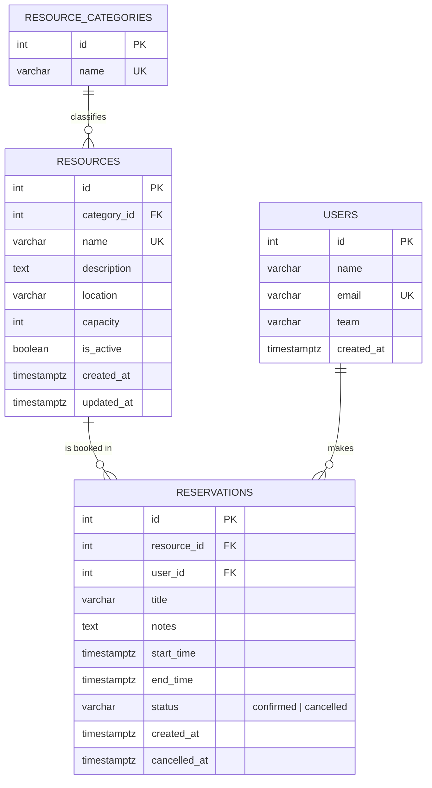

# ER Diagram

Paste the block below into https://mermaid.live (or draw.io / dbdiagram.io) and use the
**Share / Copy link** option to get the shareable link required by the submission form.

Key constraint on `reservations`: `EXCLUDE USING gist (resource_id WITH =, tstzrange(start_time, end_time, '[)') WITH &&) WHERE (status = 'confirmed')`
— the database rejects overlapping confirmed bookings of the same resource.
