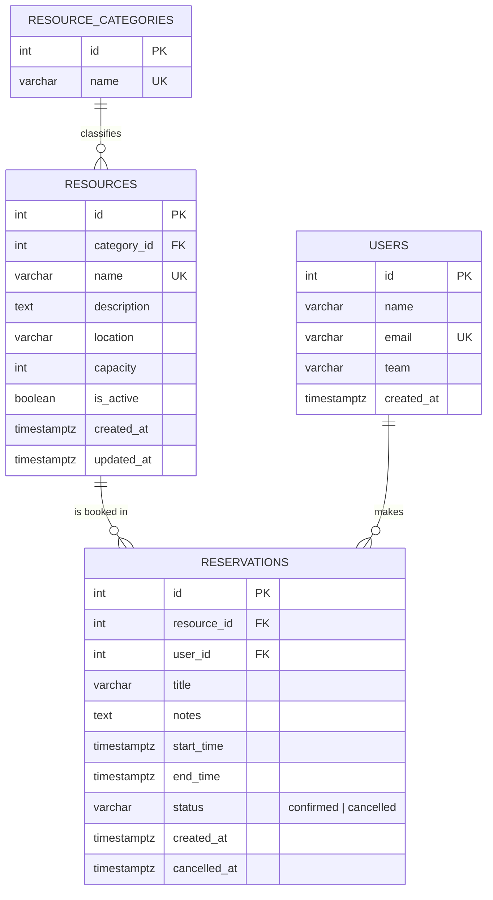

# ER Diagram

Database design for the Resource Reservation Management System. A resource belongs to one category and can have many reservations; each reservation is made by one user. A PostgreSQL exclusion constraint on reservations prevents overlapping confirmed bookings for the same resource.



## Key constraints on `reservations`

**No double-booking.** The database rejects overlapping confirmed bookings of the same resource:

```sql
CONSTRAINT no_overlapping_reservations EXCLUDE USING gist (
  resource_id WITH =,
  tstzrange(start_time, end_time, '[)') WITH &&
) WHERE (status = 'confirmed')
```

- It compares each booking's time range with the other bookings of the same `resource_id`, and rejects the insert if they overlap.
- It uses `[)` ranges, so a booking ending at 11:00 and another starting at 11:00 do not conflict (back-to-back bookings are allowed).
- It only applies to `confirmed` rows, so cancelling a reservation frees the time slot again.
- It runs inside the database, so it holds even if two people book the same slot at the same moment.

**Valid time range.** `CHECK (end_time > start_time)` guarantees that a reservation always ends after it starts.

**Allowed statuses.** `CHECK (status IN ('confirmed', 'cancelled'))` limits `status` to those two values.
